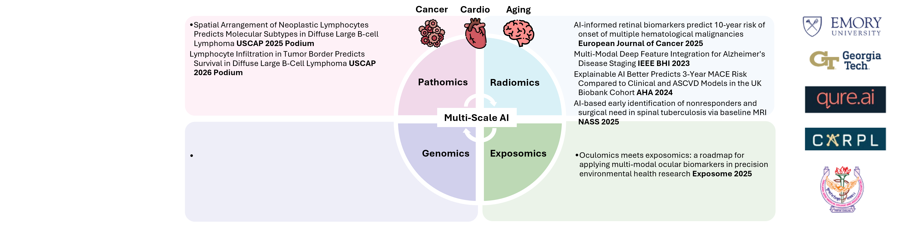
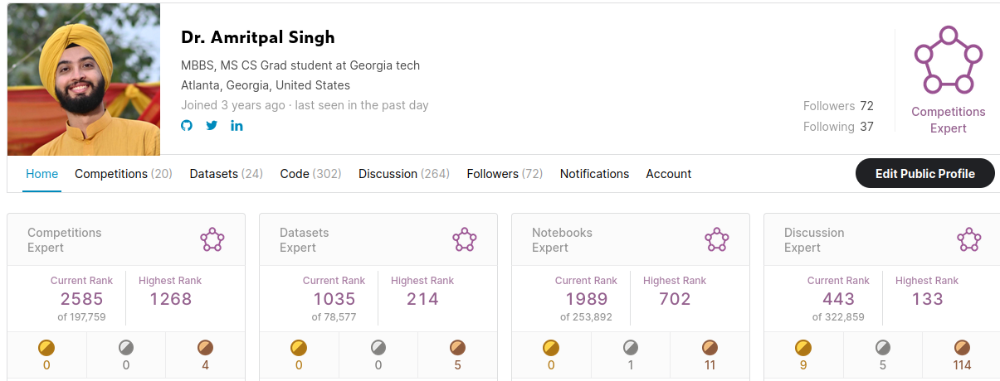
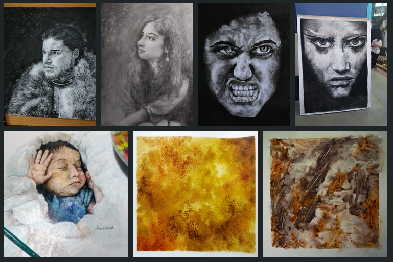

 

Dr. Amritpal Singh is a physician-scientist with training that bridges medicine, computer science, and artificial intelligence. With an M.B.B.S. from Maulana Azad Medical College and an MS in Computer Science from Georgia Tech, he has built a foundation that spans clinical care and advanced computation. His early work at the BioML Lab involved deep learning, causal inference, multimodal modeling, and medical robotics, focusing on Alzheimer’s disease, genomics, and imaging. He has also contributed as a reviewer and program committee member for major AI conferences.

He is now pursuing his PhD at Emory University under the mentorship of Dr. Anant Madabhushi, where his research centers on developing quantitative multimodal biomarkers that integrate radiology, pathology, genomics, and ocular imaging to predict patient outcomes in colorectal and lung cancer and cardiovascular disease. His broader work includes AI-driven early diagnosis, risk prediction, surgical autonomy, and continual learning, with the aim of creating clinically actionable tools that improve decision-making and transform patient care.


  You can also find my articles on <u><a href="{{author.googlescholar}}">my Google Scholar profile</a>.</u>





  


### Project links 
#### (click on image) 

        
 
 
     
 
 
       

## Areas of Interests

* Data Science and Bioinformatics
* Clinical trials and regulations
* Medical robotics
* Drug discovery for rare diseases

## Education
* PhD: Emory University: Advisor: Dr Anant Madabhushi. (2024- Present)
* M.S. in Computer Science, Georgia institute of technology, 2022 - Apr 2024
* M.B.B.S.(Bachelor of Medicine, Bachelor of Surgery: Maulana Azad Medical College, 2021

## Work experience
* Aug 2023: Research Assistant, Emory University
  * Manager: Anant Madabhushi, PhD at Madabhushi Lab
  * Developing quantitative multimodal (radiomics, pathomics, genomics) biomarkers to predict patient prognosis and outcomes. Disease area of focus: Colorectal, lung cancer, and Cardiovascular disease
* Program committee member and Research reviewer: Jan 2023 - Present
  * NEURIPS conference 2023: Deep Generative Models for Health workshop
  * NEURIPS conference 2023: GenBio(Generative AI and Biology) workshop
  * IEEE COMPSAC conference 2023, Italy
* Fall 2022: Research Assistant
  * Bio-Medical Informatics and Bio-Imaging Laboratory, Georgia Institute of Technology, Altanta
  * Advisor: May D. Wang, Ph.D. Professor of Biomedical Engineering
* 2021: Clinical Research Physician
  * Qure.ai{https://www.qure.ai} (India) 
* Junior Resident: Lok Nayak Hospital:Apr 2020 - Apr 2021
  * Clinical rotation at Lok Nayak Hospital and GB Pant Institute of Postgraduate Medical Education & Research(GIPMER), Delhi
* 2020: AI Research intern- CARING and Mahajan Imaging
* 2020: Kaggle x4 Expert

 

## Teaching
* Deep learning – Teaching Assistant, Neuromatch academy, 2021
* Computational neuroscience – Teaching Assistant, Neuromatch academy, 2021

## Hobbies

When not working on project, amrit creates on oil painting, charcoal sketches. He works on mid-size to human sized canvases. 

 

