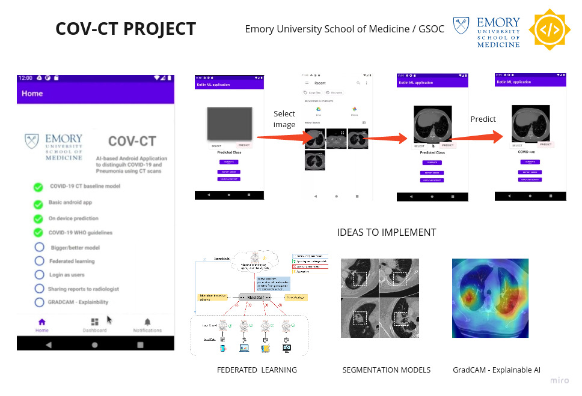

Project proposal for Google GSOC in association with Emory university school of medicine.

Github page - https://github.com/Amritpal-001/CovCT

This repository has been created for the development of an android application (CovCT) for analyzing COVID and non-COVID data. 

Mentors: Monjoy Saha

Brief Demo - 
