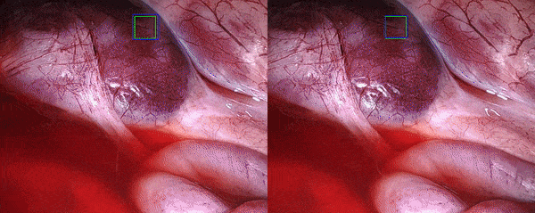

Visual tracking involves following a bounding box throughout a video sequence. This is a crucial task in Computer-Assisted Interventions (CAI), with a range of applications including soft tissue deformation estimation, lesion tracking, augmented reality and robotic visual servoing. Medical applications require accurate trackers that are robust in challenging conditions prevalent in surgery. Hence prior to being utilized in real-world practice, tissue trackers need to be evaluated in large and diverse datasets that capture multiple challenging conditions. To address this, we propose the SurgT challenge, a new first-of-a-kind collection of tools and datasets for training and benchmarking tissue trackers in surgery.

